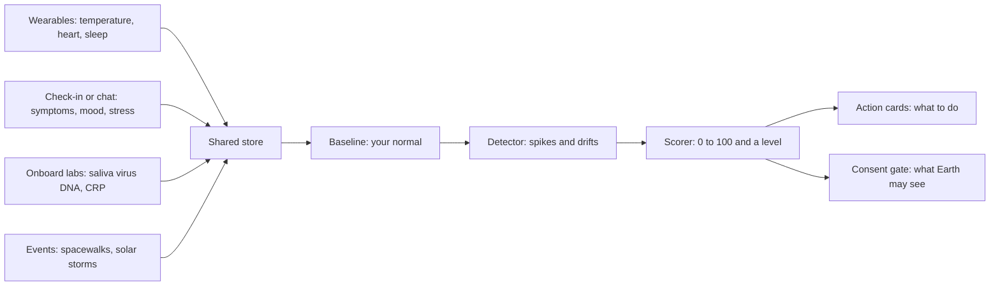
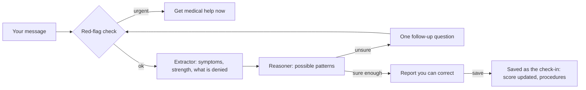

# ORBIT: Onboard Readiness & Body Insight Tracker

**An immune early-warning system for astronauts on long missions.** ORBIT
watches each astronaut's body against their *own* normal, notices when their
immune system starts to struggle, and tells the crew what to do: onboard,
without waiting for Earth.

Built for the NASA Space Apps Challenge. Python, FastAPI and SQLite in the
backend; React and TypeScript in the frontend.

> **Not medical advice.** All data is simulated, and the scoring weights,
> red flags and procedures are illustrative.

**Jump to:** [Quick start](#quick-start) · [Quick guide](QUICK_GUIDE.md) ·
[How it works](#how-it-works) · [Machine learning](#machine-learning) ·
[For developers](#for-developers)

---

## The problem

On long missions, stress, radiation, broken sleep and hard physical work weaken
the immune system. Viruses that most people carry silently (the ones behind
shingles, cold sores and glandular fever) can wake up. Near Mars, a message to
Earth takes up to 22 minutes each way, so the crew has to notice early and act
on their own.

## What ORBIT does

1. **Learns each astronaut's normal**: skin temperature, heart rate and its
   variability, breathing rate, sleep, and more.
2. **Spots changes early**, from wearables, the daily check-in and onboard lab
   tests, before the astronaut feels really ill.
3. **Turns them into one clear status** with the reasons behind it:

   | Level | Score | Meaning |
   |---|---|---|
   | 🟢 Green | 0–24 | Within your normal |
   | 🟡 Yellow | 25–49 | Keep an eye on it |
   | 🟠 Orange | 50–74 | Act on it today |
   | 🔴 Red | 75–100 | Get help now |

4. **Says what to do and who to tell**: short procedure cards, such as "Take a
   saliva sample" or "Reduce workload, tell the crew medical officer".
5. **Lets the astronaut just say how they feel.** A chat understands plain
   words, asks a few follow-up questions, shows a report the astronaut can
   correct, and saves it as their check-in.
6. **Keeps private data private.** Symptoms and mood stay onboard unless the
   astronaut chooses to share them with Earth.

---

## How it works

### The daily assessment



Every reading goes into one shared store. Each day ORBIT compares the newest
readings with the astronaut's personal baseline, flags what is unusual, scores
it from 0 to 100 with the reasons ("Skin temperature 0.45 °C above your normal
for 2 days, +9 points"), and picks the procedure cards that fit.

### The symptom chat



- **Safety first.** Every message, answer and correction passes a red-flag
  check *before* any model sees it. Trouble breathing, chest pain, fainting,
  confusion, a rash near the eye, a sudden very bad headache, trouble
  swallowing or bleeding go straight to "Get medical help now".
- **Extractor:** finds the symptoms in plain words, how strong they are, and
  what the astronaut says they *don't* have ("No rash, but a burning patch").
- **Reasoner:** ranks 8 possible patterns (shingles, cold sores, glandular
  fever, chest or throat infection, hard physical work, short sleep, stress,
  something else) using the symptoms, today's sensors, lab results and recent
  events. It asks the question that would help most, and shows patterns only
  as "likely" or "possible", never as a diagnosis.
- **Report:** the astronaut checks what ORBIT understood, fixes anything
  wrong, and saves. The score is then re-assessed right away.

### Built from swappable parts

Each step is a module in a named slot, and `orbit.toml` chooses which one runs.
Every slot has a simple, explainable starter, and some have other options,
including trained models to compare against.

| Slot | What it does | Default (`orbit.toml`) | Other options |
|---|---|---|---|
| `source` | loads data | `files` (example data) | `wearable_csv` (device exports), `simulator` (whole missions) |
| `baseline` | your normal per signal | `rolling_median` | |
| `detector` | spikes and drifts | `robust_z` | |
| `scorer` | 0–100 score and reasons | `rule_based` | `learned` (trained) |
| `actions` | procedure cards | `protocol` | |
| `sync` | what may leave the spacecraft | `consent_gate` | |
| `extractor` | symptoms from text | `lexicon` | `text_linear` (trained) |
| `reasoner` | patterns and questions | `rules` | `bayes` (trained) |

Design details and the reasons behind them: **[ARCHITECTURE.md](ARCHITECTURE.md)**.
Full module specs: **[SPEC.md](SPEC.md)**.

---

## Quick start

You need **Python 3.11+** and **Node.js 20.19+ or 22.12+**.

```bash
git clone https://github.com/rdenis03/spacemontoringsoftware.git
cd spacemontoringsoftware

python -m venv .venv
.venv\Scripts\activate            # macOS/Linux: source .venv/bin/activate
pip install -e ".[dev]"

python -m orbit demo              # the whole story in the terminal, in memory
```

Then run the app in **two terminals**:

```bash
# terminal 1: backend, http://localhost:8000 (API docs at /docs)
python -m orbit serve

# terminal 2: frontend, http://localhost:5173
cd frontend
npm install
npm run dev
```

Open **http://localhost:5173** in your browser.

To put the demo data back after trying things: stop `serve`, run
`python -m orbit reset`, then start `serve` again.

### Free hosting

- **Backend on Render:** Render → New → Blueprint → this repository. It reads
  `render.yaml`. The free disk is not persistent, so the demo data is reloaded
  after each restart, and the first request after ~15 idle minutes is slow.
- **Frontend on GitHub Pages:** Settings → Pages → Source: *GitHub Actions*,
  then add the repository variable `VITE_API_URL` (Settings → Secrets and
  variables → Actions → Variables) with the Render URL. Every push to `main`
  runs `.github/workflows/pages.yml` and publishes
  `https://<user>.github.io/<repo>/`.

---

## Quick guide

**[QUICK_GUIDE.md](QUICK_GUIDE.md)** walks through the app step by step: telling
ORBIT how you feel, answering its questions, checking and saving the report, and
what Today, Crew and Earth show. It also has the demo story and messages to try.

---

## Machine learning

ORBIT trains its models on **simulated data**: 20 missions of 180 days with 4
crew, including illnesses, look-alikes such as hard work or short sleep, and
sensor faults (plus generated sentences for the text model). It then tests
them on 5 missions the training never saw.

| Model | What it learns | Result on unseen missions |
|---|---|---|
| Learned scorer | weights for the 0–100 score | warns earlier (24 of 45 illnesses before symptom day, vs 16) with no extra false alarms |
| Text model (`text_linear`) | symptoms, severity and "no" in plain words | understands everyday wording the word list misses ("my throat kinda hurts") |
| Bayes reasoner (`bayes`) | how likely each pattern is from symptoms, sensors, labs and events | much better calibrated (Brier score 0.04 vs 0.19), and asks 1.5 questions instead of 3.6 |

**The starters stay switched on.** A trained model replaces a starter only if
it is at least as good on every agreed measure. For the scorer and the
reasoner, that rule did not pass, and the text model still needs about 200 test
sentences from people who never saw the code. The trained models are one
config away:

```bash
python -m orbit --config experiments/learned.toml serve          # learned scorer
python -m orbit --config experiments/triage_learned.toml serve   # learned chat models
```

Full numbers, how to read them, and how to reproduce them: **[docs/RESULTS.md](docs/RESULTS.md)**.

---

## Privacy and safety

- **Consent first.** Each astronaut chooses which kinds of data may leave the
  spacecraft. Score and level are always shared; symptoms, mood and stress
  stay onboard unless shared. The Earth screen shows exactly what would be sent.
- **The crew view shows only what is shared.** Private reasons appear as
  "Private reason".
- **Red flags beat models.** The urgent-symptom check is not a swappable
  module: it runs before any model, on every message, answer and correction.
- **No hidden health logic.** The scorer explains every point, and the chat
  shows its reasons for every pattern.

---

## For developers

### Commands

```bash
python -m orbit demo                 # full scenario in memory, safe to repeat
python -m orbit serve [--port 8000]  # API; loads the example data if the database is empty
python -m orbit status AST-01        # latest status in the terminal
python -m orbit triage AST-01 "..." --as-of <time> [--answer ...]   # a chat in the terminal
python -m orbit run                  # re-run daily assessments
python -m orbit ingest               # load the sources in orbit.toml
python -m orbit modules              # which modules exist and which are active
python -m orbit reset                # delete the database
python -m pytest                     # 568 tests
```

Every command accepts `--config path/to/orbit.toml` and `--database path` (or `":memory:"`).

### API

Interactive docs with examples: **http://localhost:8000/docs**. The main routes:

| Route | For |
|---|---|
| `GET /api/signals` | labels, units, scales and level thresholds (the frontend never hard-codes these) |
| `GET /api/crew/{id}/status` | today's level, reasons, anomalies and procedures (`?view=shared` for the crew view) |
| `GET /api/crew/{id}/day?as_of=` | the same for a past day (replay) |
| `POST /api/crew/{id}/checkin` | save the quick check-in and re-assess |
| `POST /api/crew/{id}/triage` | start a chat, then `…/{session}/answer`, `…/confirm` and `…/cancel` |
| `GET /api/overview` | the crew view |
| `PUT /api/crew/{id}/consent`, `GET …/earth-packet`, `POST …/earth-packet/send`, `GET /api/outbox` | sharing with Earth |
| `GET /api/crew/{id}/observations`, `…/baselines`, `…/assessments` | charts |

### Project layout

```
orbit/
  schema/      the data contract: 25 signals, models and validation rules
  core/        slots, registry, config, SQLite store, pipeline
  modules/     the modules for every slot (starters and trained ones)
  triage/      the chat service, red flags and procedure library
  learning/    trainers and the trained weights (readable JSON)
  evaluation/  metrics and the comparison runner
  api/         FastAPI app
frontend/      React + TypeScript app (see frontend/README.md and DESIGN.md)
cards/         procedure cards, questions, red flags, symptom words (hand-written, checked on load)
examples/      the demo data: mission days 70–90 for two astronauts
experiments/   configs that switch on the trained models
reports/       committed evaluation results
tests/         568 tests: schema, store, pipeline, contracts, API, models and chat
```

### Adding a module

1. Read the slot's interface in `orbit/core/interfaces.py`.
2. Create `orbit/modules/<name>.py` with `@register("<slot>", "<name>")` and
   import it in `orbit/modules/__init__.py`.
3. Run `python -m pytest tests/test_contracts.py` to check it fits the slot.
4. Set `use = "<name>"` in `orbit.toml`.

Modules are pure: no database, network or clock inside them. Everything they
need arrives in one context object, which keeps them easy to test and replay.

---

## Limits

- **Simulated data only.** The simulator makes the problem cleaner than real
  bodies are, so real-world performance is unknown.
- **Illustrative medicine.** Thresholds, red flags and procedure cards were
  written for the demo, not by flight surgeons.
- **English only** for the chat, and its text model still needs real test
  sentences before it can be trusted.
